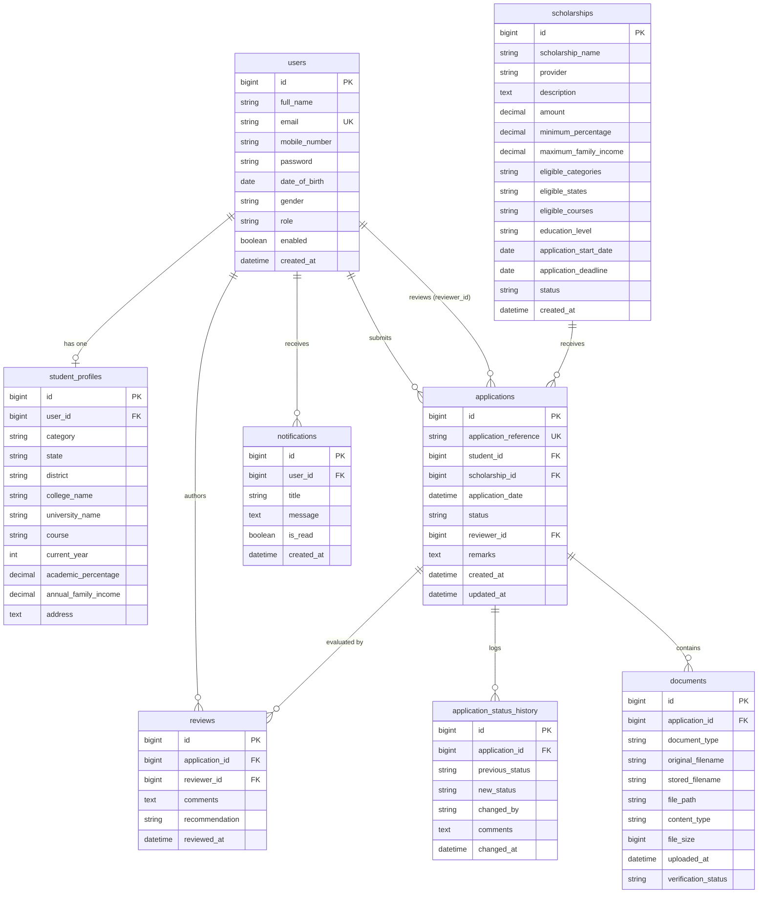
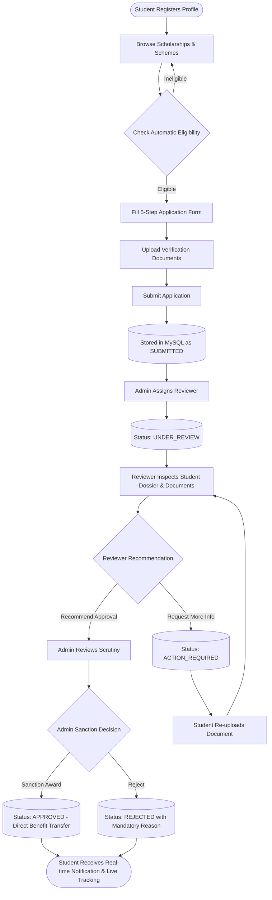

# ScholarConnect – Student Scholarship Portal

> **Third-Year B.Tech Academic Capstone Project**  
> An enterprise-grade, secure, responsive, and fully integrated Student Scholarship Portal inspired by India's National Scholarship Portal (NSP). Built with **Spring Boot 3**, **Spring Security (JWT + RBAC)**, **Spring Data JPA**, **MySQL 8**, **Bootstrap 5**, and **Chart.js**.

---

## 🏛️ Project Overview

ScholarConnect bridges deserving students with government, university, and philanthropic scholarship opportunities. The system features an **automated rule-based eligibility evaluation engine**, a **multi-step scholarship application workflow**, **secure document upload and scrutiny management**, **real-time visual timeline tracking**, and **role-based administrative dashboards with live Chart.js visualizations**.

### Key Highlights
- **100% Real Full-Stack Integration:** No hardcoded statistics or mock API responses. The frontend connects dynamically to Spring Boot REST endpoints and persists all transactions in MySQL.
- **Rule-Based Eligibility Engine:** Automatically checks student profile criteria (academic percentage, family income, social category, domicile state, course, and active deadlines) and provides transparent pass/fail explanations.
- **Multi-Step Application Form:** Guided 5-step application process with client-side and server-side validation.
- **Three-Tier RBAC:** Strict backend authorization enforcing distinct operational boundaries for **Students**, **Reviewers**, and **Administrators**.
- **Audit Trail & Document Isolation:** Application status changes are archived in historical audit logs (`application_status_history`) and private documents are served through authenticated authorization endpoints.

---

## 🛠️ Technology Stack

| Layer | Technologies |
| :--- | :--- |
| **Frontend** | HTML5, CSS3, JavaScript (Vanilla ES6+), Bootstrap 5.3, Bootstrap Icons, Chart.js |
| **Backend** | Java 17/21, Spring Boot 3.3.5, Spring Web, Spring Data JPA, Spring Security 6, Spring Validation |
| **Authentication** | JWT (JSON Web Tokens via JJWT 0.12.6) + BCrypt Password Hashing |
| **Database** | MySQL 8.0 (InnoDB, Normalized Relational Schema) |
| **Build & Tooling** | Maven 3.9+, Git, MySQL Workbench, Postman |

---

## 🗄️ Database Design (`scholarship_portal`)

The relational database consists of 8 normalized tables with foreign key constraints, indexing, and cascade rules:



---

## 🔄 End-to-End Workflow



---

## 👥 Seed Accounts & Demo Credentials

The portal is pre-seeded with verified test accounts across all roles:

| Role | Name | Email | Password | Purpose |
| :--- | :--- | :--- | :--- | :--- |
| **ADMIN** | System Administrator | `admin@scholarconnect.gov.in` | `Admin@123` | Executive dashboard, scheme CRUD, reviewer assignment, final sanction |
| **REVIEWER** | Dr. Arvinder Singh | `reviewer1@scholarconnect.gov.in` | `Reviewer@123` | Assigned application scrutiny, document verification, approval recommendation |
| **REVIEWER** | Prof. Meenakshi Sundaram | `reviewer2@scholarconnect.gov.in` | `Reviewer@123` | Document inspection and corrective action requests |
| **STUDENT** | Rahul Sharma | `rahul.sharma@example.com` | `Student@123` | B.Tech student, 85.5% marks, General category |
| **STUDENT** | Priya Patel | `priya.patel@example.com` | `Student@123` | B.Tech student, 79.2% marks, OBC category |
| **STUDENT** | Ananya Verma | `ananya.verma@example.com` | `Student@123` | Meritorious student, SC category, Approved award |
| **STUDENT** | Vikram Singh | `vikram.singh@example.com` | `Student@123` | Student with rejected income threshold |
| **STUDENT** | Sneha Reddy | `sneha.reddy@example.com` | `Student@123` | Student with pending bonafide re-upload |

> **Pro Tip:** The login page (`login.html`) includes **1-Click Quick Demo Login buttons** for Student, Admin, and Reviewer to accelerate live project demonstrations for external examiners.

---

## 🚀 Quick Start Guide (Local Setup)

### Prerequisites
- **Java 17 or Java 21 LTS**
- **Apache Maven 3.8+**
- **MySQL 8.0** running on `localhost:3306`

### 1. Database Setup
Log into your local MySQL instance and create the database:
```sql
CREATE DATABASE scholarship_portal CHARACTER SET utf8mb4 COLLATE utf8mb4_unicode_ci;
```
*(Optional: You can manually run `database/schema.sql` and `database/data.sql`, but the Spring Boot `DataInitializer` component will automatically ensure default accounts, scholarships, applications, and documents are initialized on first startup!)*

### 2. Configure Database Credentials (Optional)
If your local MySQL root password is not `root`, set environment variables or edit `src/main/resources/application.properties`:
```properties
spring.datasource.url=jdbc:mysql://localhost:3306/scholarship_portal?createDatabaseIfNotExist=true&useSSL=false&allowPublicKeyRetrieval=true&serverTimezone=UTC
spring.datasource.username=root
spring.datasource.password=YOUR_PASSWORD
```

### 3. Build & Run Spring Boot
In the project root directory, run:
```powershell
mvn spring-boot:run
```
Or package and execute the standalone executable jar:
```powershell
mvn clean package -DskipTests
java -jar target/scholarconnect-portal-1.0.0.jar
```

### 4. Access the Portal
Once Tomcat starts on port `8080`, open your web browser:
- **Unified Portal Homepage:** `http://localhost:8080/`
- **Login Page:** `http://localhost:8080/login.html`
- **Scholarship Directory:** `http://localhost:8080/scholarships.html`
- **Student Dashboard:** `http://localhost:8080/student-dashboard.html`
- **Admin Console:** `http://localhost:8080/admin-dashboard.html`
- **Reviewer Desk:** `http://localhost:8080/reviewer-dashboard.html`

*(Note: The standalone `frontend/` folder can also be launched via VS Code Live Server or deployed to static hosting providers, connecting directly to `http://localhost:8080/api` through configured CORS).*

---

## 📡 REST API Specifications

### Authentication (`/api/auth`)
- `POST /api/auth/register` – Register a new student account & profile
- `POST /api/auth/login` – Authenticate student/admin/reviewer, returns JWT token & role
- `POST /api/auth/logout` – Clear user session
- `GET /api/auth/me` – Retrieve profile of current authenticated user

### Scholarships (`/api/scholarships`)
- `GET /api/scholarships` – Public catalog of active scholarships (with category, state, and level filters)
- `GET /api/scholarships/{id}` – Full criteria & description for a single scheme
- `GET /api/scholarships/search?q={keyword}` – Full-text keyword search across schemes
- `GET /api/scholarships/{id}/eligibility` – Real-time rule-based eligibility evaluation for logged-in student

### Applications (`/api/applications`)
- `POST /api/applications` – Submit 5-step scholarship application with documents
- `GET /api/applications/my` – Retrieve logged-in student's applications
- `GET /api/applications/{id}` – Retrieve application dossier (ownership/RBAC protected)
- `GET /api/applications/{id}/tracking` – Retrieve visual 5-stage progress stepper milestones & audit trail

### Document Management (`/api/documents`)
- `POST /api/documents/upload` – Multipart file upload (PDF/PNG/JPG, max 10MB)
- `GET /api/documents/{id}` – Authenticated streaming download (students can only view their own; assigned reviewers & admins have clearance)
- `DELETE /api/documents/{id}` – Delete uploaded document

### Admin Console (`/api/admin`)
- `GET /api/admin/dashboard` – System-wide counts, recent activity, and 4 Chart.js analytics feeds
- `GET /api/admin/users` – List all registered candidates & reviewers
- `GET /api/admin/applications` – Filtered list of all applications across schemes
- `POST /api/admin/scholarships` – Create new scholarship scheme
- `PUT /api/admin/scholarships/{id}` – Update scheme parameters & criteria
- `DELETE /api/admin/scholarships/{id}` – Deactivate / remove scheme
- `PUT /api/admin/applications/{id}/assign-reviewer` – Assign application to reviewer
- `PUT /api/admin/applications/{id}/status` – Approve, reject, or request information with mandatory comments

### Reviewer Workspace (`/api/reviewer`)
- `GET /api/reviewer/dashboard` – Queue counts and assigned dossiers
- `GET /api/reviewer/applications` – Applications assigned to the logged-in reviewer
- `POST /api/reviewer/applications/{id}/review` – Submit scrutiny recommendation & notes
- `PUT /api/reviewer/documents/{id}/verify` – Mark document status as `VERIFIED` or `REJECTED`

### Notifications (`/api/notifications`)
- `GET /api/notifications` – Fetch live alerts & status updates
- `PUT /api/notifications/{id}/read` – Mark single notification read
- `PUT /api/notifications/read-all` – Mark all notifications read

---

## 📮 Postman Collection

Import `postman/ScholarConnect_API.postman_collection.json` into Postman. It contains pre-configured requests for all endpoints with automated test scripts that save and propagate JWT tokens between requests.

---

## ☁️ Deployment Instructions

### 1. Frontend Deployment (Vercel)
1. Fork or push the `frontend/` directory to a GitHub repository.
2. Link the repository to [Vercel](https://vercel.com/).
3. In `frontend/js/config.js`, update `API_BASE_URL` to point to your live backend domain (e.g., `https://scholarconnect-backend.up.railway.app/api`).
4. Deploy as a static website with output root set to `/`.

### 2. Backend Deployment (Render or Railway)
1. Link your repository containing `pom.xml` and the `src/` directory to Railway or Render.
2. Add environment variables in your deployment dashboard:
   - `DB_URL`: `jdbc:mysql://<host>:<port>/<dbname>?useSSL=true`
   - `DB_USERNAME`: Database user
   - `DB_PASSWORD`: Database password
   - `JWT_SECRET`: 256-bit Base64-encoded secret key
3. Build command: `mvn clean package -DskipTests`
4. Start command: `java -jar target/scholarconnect-portal-1.0.0.jar`

### 3. Managed MySQL Database
Use any compatible MySQL 8 cloud provider:
- **Railway MySQL Plugin**
- **Aiven for MySQL**
- **PlanetScale** or **AWS RDS MySQL**
Import `database/schema.sql` and `database/data.sql` to preload initial records.

---

## 🎓 Academic Demonstration Guide (B.Tech Viva)

When demonstrating this project to professors or examiners:
1. **Homepage:** Show government-style UI, active statistics counter, and featured schemes.
2. **Registration & Rule-Based Eligibility:** Register a student with 85% marks and family income ₹3,80,000. Open `scholarship-details.html` and click **"Check My Eligibility"** to showcase the automated rule evaluation engine.
3. **Multi-Step Application:** Fill out the 5-step form, attach documents, review the snapshot, and submit. Highlight the unique generated reference ID (`SC-2026-XXXXX`).
4. **Duplicate Prevention:** Re-attempt applying to the same scholarship to show error handling.
5. **Reviewer Scrutiny:** Log in as `reviewer1@scholarconnect.gov.in`. Open the assigned dossier, verify each document, and submit a review recommendation.
6. **Admin Sanction:** Log in as `admin@scholarconnect.gov.in`. View the executive dashboard with dynamic Chart.js visualizations, open the application registry, and sanction the final approval.
7. **Live Timeline Tracking:** Return to the student portal and view `track-application.html` to demonstrate the updated 5-stage progress timeline and status history audit trail.
8. **RBAC Security Test:** Demonstrate that a student attempting to access another student's document or admin endpoints receives an immediate `403 Forbidden` response.

---

## 📄 License
Academic Project under MIT License. All sample scholarship records are realistic demo simulations designed for educational demonstration.
